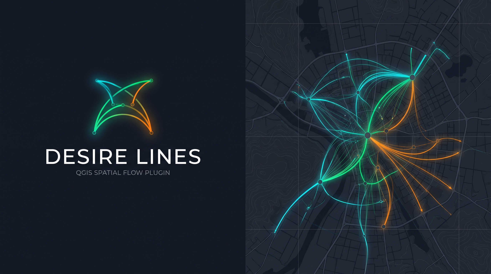

<p align="center">
  
</p>

<p align="center"><b>English</b> · <a href="README.pt-BR.md">Português (Brasil)</a></p>

# Desire Lines

From an origin/destination matrix to desire lines and assigned demand, inside QGIS.

**Version 0.7.4** · QGIS 3.0 to 4.x · Qt5 and Qt6 · GPL-2.0

📖 Documentation (in Portuguese): https://desirelines.dcamargo.com.br

## What it does

Desire Lines is a QGIS plugin for transport demand analysis starting from an Origin/Destination (OD) matrix. From the matrix and a traffic-zone layer it produces centroids, desire lines and assigned demand, either over a synthetic neighbourhood network or over the real highway network, with capacity computed per the HCM 6th edition. It is made for transport planners, not programmers, and every step writes a table to the same output GeoPackage.

The plugin offers a main dialog with three tabs and a dockable panel:

1. **OD Matrix**: imports the OD matrix (CSV) and the traffic-zone layer, and generates the centroids.
2. **Desire Lines**: draws one straight line per OD pair between centroids, with width proportional to flow and a graduated (Natural Breaks) style you can edit in Symbology.
3. **AoN (Delaunay)**: All-or-Nothing assignment over a synthetic Delaunay network of centroids, with optional split by direction (`flow_ab` / `flow_ba`). The metric CRS is chosen automatically (UTM, or SIRGAS 2000 / Brazil Albers, EPSG:10857, for wide areas).
4. **Highway Assignment** (dockable panel): per-direction capacity by HCM 6th edition (ch. 15 two-lane, ch. 12 multilane and freeway) and assignment over the real highway network (DNIT/SNV and state DER networks via GISBR). Methods are All-or-Nothing, MSA + BPR equilibrium, or Frank-Wolfe equilibrium (recommended default).
   - Output: volume, capacity, v/c, approximate LOS by v/c band, time, delay, method, scope, and the provenance of every HCM parameter. No parameter is assumed silently: each has a documented default, overridable globally or by layer field.
   - Capacity, free-flow time, one-way and BPR alpha/beta can be read from layer attributes.
   - Validated against the Sioux Falls user-equilibrium benchmark.

## Installation

### From the QGIS plugin repository

In QGIS, go to **Plugins → Manage and Install Plugins**, search for "Desire Lines" and install it.

### From a ZIP file

Open QGIS and go to **Plugins → Manage and Install Plugins**.


In the Plugins window, choose **Install from ZIP** (1), locate the downloaded file (2) and click **Install Plugin**.


QGIS shows a security warning during installation. Click **Yes** to continue.


When QGIS confirms the installation, close the Plugins window.

### Where it appears

The plugin adds a single toolbar button with a drop-down arrow: the icon opens the Desire Lines dialog, and the arrow menu offers Desire Lines and Highway Assignment. It is also available under **Vector → Desire Lines**.


### GISBR (optional)

[GISBR](https://github.com/d-camargo/gisbr) is only needed to download the official highway network. Without it, a dialog suggests installing it (with a "Don't show again" option). The three tabs work normally, and the highway panel still works with a network layer already loaded in the project. Only the download is disabled.

## Scope

> [!WARNING]
> Highway assignment is meant for **rural and interurban highways**. Urban crossings inside the network are flagged `escopo = 'urbano'` with a warning; they are not recomputed with an urban procedure.

## Quick start with sample data

The `examples/` folder has two datasets ready to use:

- `examples/RMSP`: São Paulo Metropolitan Region, 2017 OD survey table and zones GeoPackage.
- `examples/Microrregioes_MG`: Minas Gerais micro-regions, OD matrix and GeoPackage.

For an end-to-end walkthrough, see the tutorial: https://desirelines.dcamargo.com.br/guias/exemplos/

## Development

```bash
make deploy            # symlinks desire_lines/ into the default QGIS profile
make deploy-flatpak    # same, for Flatpak QGIS
make undeploy          # removes the symlink
make undeploy-flatpak  # removes the symlink (Flatpak)
```

After deploying, reload the plugin with the Plugin Reloader.

## From the blog

Posts about the plugin on dcamargo.com.br, newest first:

- [Sioux Falls and Frank-Wolfe: equilibrium assignment in Desire Lines](https://www.dcamargo.com.br/en/2026/10/30/desire-lines-frank-wolfe-sioux-falls.html) (2026-10-30)
- [Origin-Destination Matrix: how to read the table and when to stack the data](https://www.dcamargo.com.br/en/2026/10/27/origin-destination-matrix-how-to-read-the-table-and-when.html) (2026-10-27)
- [Desire Lines 0.3.2: Portuguese interface and QGIS 4.x (Qt6) compatibility](https://www.dcamargo.com.br/en/2026/07/14/desire-lines-pt-br-qt6-qgis4.html) (2026-07-14)
- [Desire Lines 0.2.0: AoN allocation on Delaunay networks and QGIS usability updates](https://www.dcamargo.com.br/en/2026/06/03/desire-lines-aon-delaunay-qgis.html) (2026-06-03)
- [Desire Lines plugin available in the official QGIS repository](https://www.dcamargo.com.br/en/2026/05/21/plugin-desire-lines-oficial-qgis.html) (2026-05-21)

## Documentation & support

- Documentation (in Portuguese): https://desirelines.dcamargo.com.br
- Issues: https://github.com/d-camargo/desire_lines/issues
- Changelog: [docs/changelog.md](docs/changelog.md) (also in `desire_lines/metadata.txt`)

## License

GPL-2.0, see [LICENSE](LICENSE). Author: Diego Camargo.
