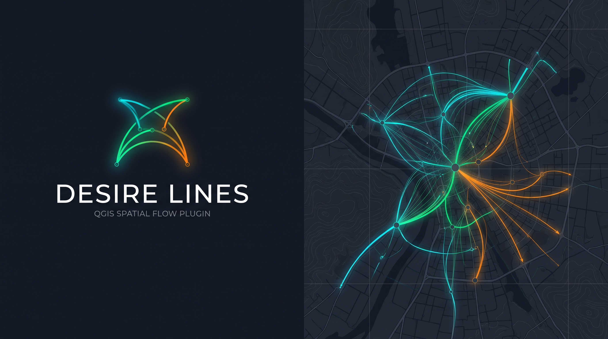

<p align="center">
  
</p>

<p align="center"><a href="README.md">English</a> · <b>Português (Brasil)</b></p>

# Desire Lines

Da matriz origem/destino às linhas de desejo e à demanda alocada, dentro do QGIS.

**Versão 0.7.4** · QGIS 3.0 a 4.x · Qt5 e Qt6 · GPL-2.0

📖 Documentação: https://desirelines.dcamargo.com.br

## O que faz

O Desire Lines é um plugin do QGIS para análise de demanda de transporte a partir de uma matriz Origem/Destino (OD). Com a matriz e uma camada de zonas de tráfego, ele gera centroides, linhas de desejo e demanda alocada, seja sobre uma rede sintética de vizinhança, seja sobre a malha rodoviária real, com a capacidade calculada pelo HCM 6ª edição. Foi feito para planejadores de transporte, não para programadores, e cada etapa grava uma tabela no mesmo GeoPackage de saída.

O plugin tem um diálogo principal com três abas e um painel acoplável:

1. **Matriz OD**: importa a matriz OD (CSV) e a camada de zonas de tráfego, e gera os centroides.
2. **Linhas de desejo**: desenha uma reta por par OD entre os centroides, com espessura proporcional ao fluxo e estilo graduado (Natural Breaks) que você pode editar em Simbologia.
3. **AoN (Delaunay)**: alocação Tudo-ou-Nada (All-or-Nothing) sobre uma rede sintética de Delaunay entre os centroides, com separação opcional por sentido (`flow_ab` / `flow_ba`). O SRC métrico é escolhido automaticamente (UTM, ou SIRGAS 2000 / Brazil Albers, EPSG:10857, para áreas extensas).
4. **Alocação em rodovias** (painel acoplável): capacidade por sentido pelo HCM 6ª edição (cap. 15 pista simples, cap. 12 pista dupla e autoestrada) e alocação sobre a malha rodoviária real (redes DNIT/SNV e DERs estaduais via GISBR). Os métodos são Tudo-ou-Nada, equilíbrio MSA + BPR ou equilíbrio Frank-Wolfe (padrão recomendado).
   - Saída: volume, capacidade, v/c, nível de serviço (LOS) aproximado por faixa de v/c, tempo, atraso, método, escopo e a procedência de cada parâmetro do HCM. Nenhum parâmetro é assumido em silêncio: cada um tem um padrão documentado, que pode ser alterado globalmente ou por campo da camada.
   - Capacidade, tempo em fluxo livre, mão única e alfa/beta da BPR podem ser lidos dos atributos da camada.
   - Validado com o benchmark de equilíbrio do usuário de Sioux Falls.

## Instalação

### Pelo repositório de plugins do QGIS

No QGIS, vá em **Complementos → Gerenciar e Instalar Complementos**, procure por "Desire Lines" e instale.

### Por arquivo ZIP

Abra o QGIS e vá em **Complementos → Gerenciar e Instalar Complementos**.


Na janela de complementos, escolha **Instalar a partir do ZIP** (1), localize o arquivo baixado (2) e clique em **Instalar Complemento**.


Durante a instalação, o QGIS mostra um aviso de segurança. Clique em **Sim** para continuar.


Quando o QGIS confirmar a instalação, feche a janela de complementos.

### Onde ele aparece

O plugin adiciona um único botão na barra de ferramentas, com uma seta de menu: o ícone abre o diálogo Desire Lines, e o menu da seta oferece Desire Lines e Alocação em rodovias. Ele também está em **Vetor → Desire Lines**.


### GISBR (opcional)

O [GISBR](https://github.com/d-camargo/gisbr) só é necessário para baixar a malha rodoviária oficial. Sem ele, um diálogo sugere instalá-lo (com a opção "Não mostrar novamente"). As três abas funcionam normalmente, e o painel de rodovias continua funcionando com uma camada de rede já carregada no projeto. Só o download fica desativado.

## Escopo

> [!WARNING]
> A alocação em rodovias é voltada a **rodovias rurais e interurbanas**. Travessias urbanas dentro da rede são marcadas com `escopo = 'urbano'` e um aviso; elas não são recalculadas por um procedimento urbano.

## Primeiros passos com dados de exemplo

A pasta `examples/` traz dois conjuntos de dados prontos para uso:

- `examples/RMSP`: Região Metropolitana de São Paulo, tabela da pesquisa OD 2017 e GeoPackage das zonas.
- `examples/Microrregioes_MG`: microrregiões de Minas Gerais, matriz OD e GeoPackage.

Para um passo a passo completo, veja o tutorial: https://desirelines.dcamargo.com.br/guias/exemplos/

## Desenvolvimento

```bash
make deploy            # cria link simbólico de desire_lines/ no perfil padrão do QGIS
make deploy-flatpak    # idem, para o QGIS em Flatpak
make undeploy          # remove o link simbólico
make undeploy-flatpak  # remove o link simbólico (Flatpak)
```

Depois do deploy, recarregue o plugin com o Plugin Reloader.

## No blog

Posts sobre o plugin em dcamargo.com.br, do mais recente ao mais antigo:

- [Sioux Falls e o Frank-Wolfe: alocação de equilíbrio no Desire Lines](https://www.dcamargo.com.br/2026/10/30/desire-lines-frank-wolfe-sioux-falls.html) (30/10/2026)
- [Matriz Origem e Destino: como ler a tabela e quando empilhar os dados](https://www.dcamargo.com.br/2026/10/27/matriz-origem-e-destino-como-ler-a-tabela-e-quando-empilhar.html) (27/10/2026)
- [Desire Lines 0.3.2: interface em português e compatibilidade com QGIS 4.x (Qt6)](https://www.dcamargo.com.br/2026/07/14/desire-lines-pt-br-qt6-qgis4.html) (14/07/2026)
- [Desire Lines 0.2.0: Alocação AoN sobre redes Delaunay e melhorias de usabilidade no QGIS](https://www.dcamargo.com.br/2026/06/03/desire-lines-aon-delaunay-qgis.html) (03/06/2026)
- [Plugin Desire Lines disponível no repositório oficial do QGIS](https://www.dcamargo.com.br/2026/05/21/plugin-desire-lines-oficial-qgis.html) (21/05/2026)

## Documentação e suporte

- Documentação: https://desirelines.dcamargo.com.br
- Issues: https://github.com/d-camargo/desire_lines/issues
- Changelog: [docs/changelog.md](docs/changelog.md) (também em `desire_lines/metadata.txt`)

## Licença

GPL-2.0, veja [LICENSE](LICENSE). Autor: Diego Camargo.
